<p align="center">
  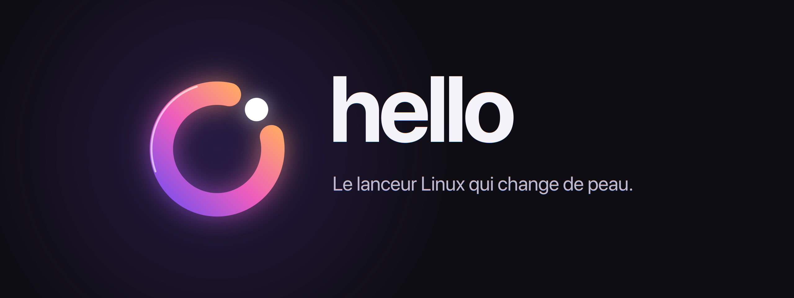
</p>

<p align="center">
  <b>Un lanceur pour Linux, façon Raycast ou Alfred : apps, terminal, presse-papiers, emoji, couleurs, IA… derrière Alt Espace.</b><br>
  Python · GTK 4 · libadwaita · Wayland · KDE Plasma 6, GNOME, Hyprland, Sway
</p>

<p align="center">
  <a href="https://github.com/matthieuleconte1/HelloLinux/releases/latest"><b>Télécharger la 2.1</b></a> ·
  <a href="https://github.com/matthieuleconte1/Hello">Version macOS</a> ·
  <a href="#ce-que-fait-hello">Fonctionnalités</a> ·
  <a href="#sept-peaux">Sept peaux</a> ·
  <a href="#installation">Installation</a>
</p>

<p align="center">
  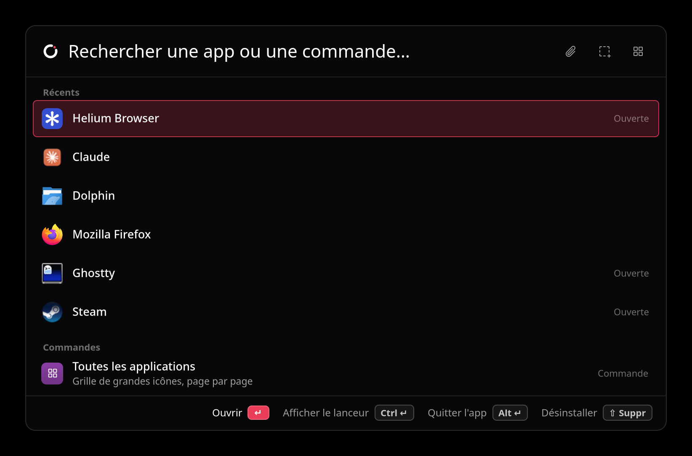
</p>

C'est le portage de [Hello pour macOS](https://github.com/matthieuleconte1/Hello) : les six peaux de la version Mac,
plus un style **KDE** (celui par défaut) qui suit le thème de Plasma. C'est un portage, pas une traduction ligne à
ligne : SwiftUI, AppKit et Carbon n'existent pas sous Linux, chaque brique système a donc son équivalent Linux
([tableau plus bas](#ce-qui-change-par-rapport-à-macos)).

## Nouveau dans la 2.1

<table>
  <tr>
    <td width="50%">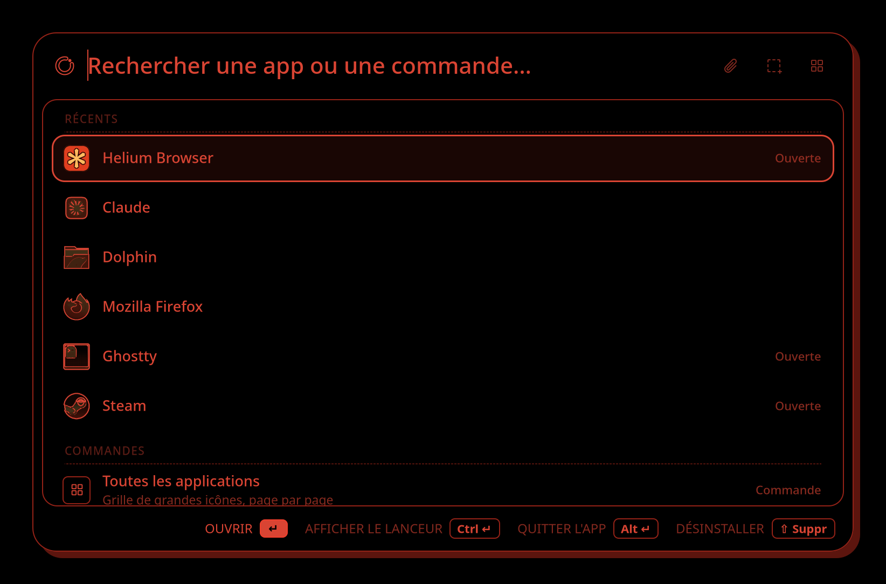</td>
    <td width="50%">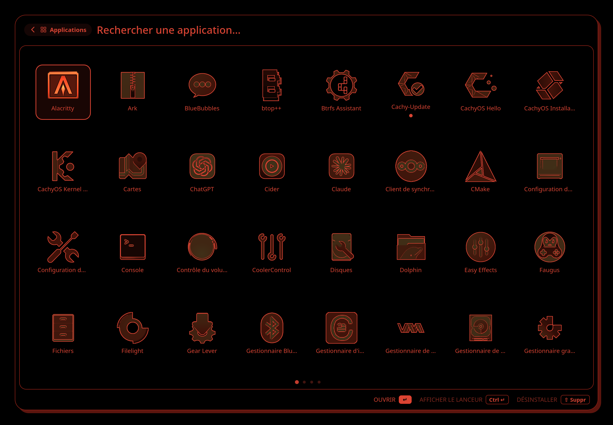</td>
  </tr>
  <tr>
    <td><b>La Nuit, au trait.</b> Tout passe dans un seul rouge sur du noir : la ligne choisie est cernée, ce qu'elle contient se remplit. Statuts de l'IA, niveaux et liens suivent. Automatique aux heures choisies.</td>
    <td><b>Icônes dessinées à l'encre.</b> Contour et traits intérieurs détourés automatiquement (XDoG), sur leur couleur atténuée ; l'icône choisie se remplit. Contour, détail, opacité et couleurs réglables.</td>
  </tr>
  <tr>
    <td>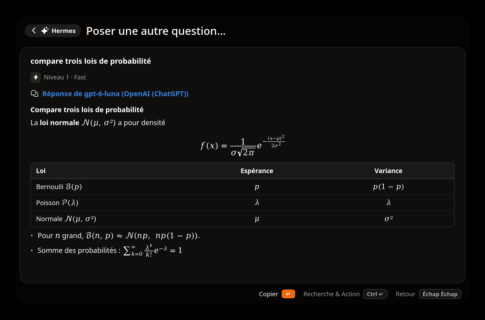</td>
    <td>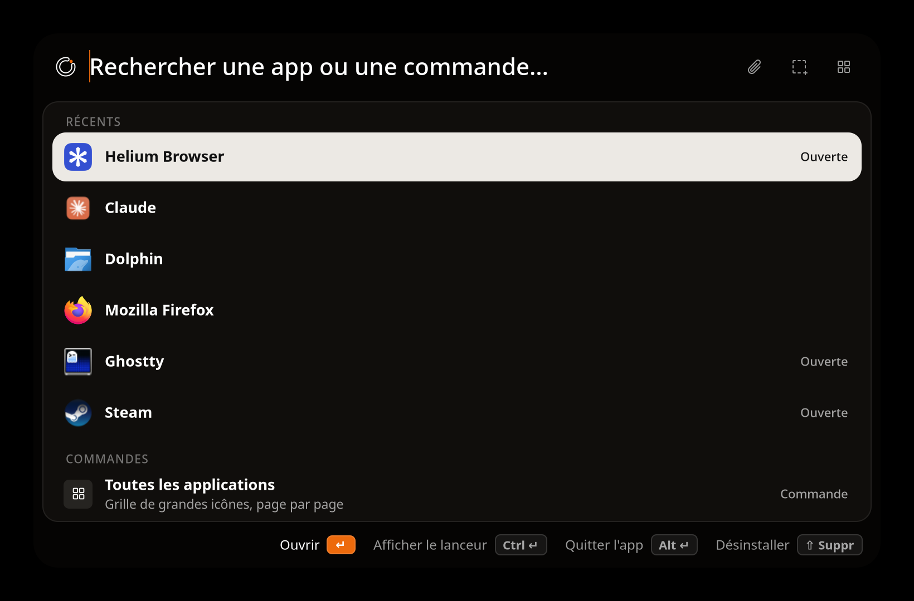</td>
  </tr>
  <tr>
    <td><b>L'IA écrit en Markdown et en LaTeX.</b> Tableaux, listes, code et formules (fractions, racines, sommes, matrices, <code>cases</code>, <code>aligned</code>) composés par Hello lui-même, sans LaTeX installé. Clic droit : copier le LaTeX.</td>
    <td><b>Glyphe sombre retouché.</b> Le panneau se détache mieux du cadre, la sélection passe en blanc cassé, les métadonnées sont plus lisibles. Dans les grilles, apps et emoji passent de l'ASCII à l'image en fondu.</td>
  </tr>
</table>

## Ce que fait Hello

Tu appuies sur **Alt Espace**, tu tapes deux lettres, c'est ouvert. Hello apprend ce que tu utilises (« fir » →
Firefox apprend aussi « f » et « fi »), donc une ou deux lettres suffisent vite.

| Tape | Effet |
|---|---|
| `fir` | Ouvre Firefox : recherche floue, classement par **frécence** (fréquence × récence) et préfixes appris ; les apps Flatpak comprises |
| `apps` ou ▦ | Toutes les applications en grandes icônes, par pages : pavé tactile, molette, Ctrl ← → ou Page ↑ ↓ |
| `cd ~/code`, `z proj` | Ouvre le dossier dans le gestionnaire de fichiers (Ctrl ↵ : terminal, Alt ↵ : éditeur) ; ⇥ complète le chemin, branche git affichée |
| `> git status` | Exécute dans le shell, sortie en couleur dans Hello (Ctrl ↵ : dans le terminal, Ctrl C stop, Ctrl R relancer) |
| `kill slack`, `port 3000`, `ip` | Terminer un processus, voir qui écoute sur un port, adresses IP |
| `presse` | Historique du presse-papiers : texte, images, fichiers (↵ colle, Ctrl ↵ copie) |
| `emoji` | Emoji et symboles Unicode, recherche en français ou en anglais |
| `couleur` | Pipette : HEX copié, puis HEX / RGB / HSL |
| `désinstaller` ou ⇧ Suppr sur une app | Désinstallation propre : Flatpak, paquet ou app locale, et ses restes, en choisissant ce qu'on garde |
| `? ta question` | Agent IA : réponse rapide, recherche web et actions, ou session de code dans le terminal |
| `gh torvalds/linux` | Commandes perso avec argument `{}` |
| `panneau`, `stats`, `style`, `focus` | Panneau Plasma, statistiques, changement de style, mode focus |

`↑↓` naviguer · `↵` action · `Ctrl ↵` / `Alt ↵` actions secondaires · `⇧ ↵` copier · `Échap` retour · `Ctrl ,` réglages

Dans une conversation IA, deux pressions distinctes sur **Échap** en moins de 2,5 secondes arrêtent la réponse en
cours ou reviennent à la recherche si elle est terminée. Une saisie en cours est d'abord effacée. **Ctrl W** masque
Hello et laisse l'IA travailler : une notification prévient quand elle a fini.

## Sept peaux

Le même lanceur, sept directions artistiques complètes. Chacune a ses couleurs, sa typographie, sa sélection, ses
icônes et **ses propres animations**.

<table>
  <tr>
    <td width="25%"><p align="center"><b>KDE</b></p></td>
    <td width="25%">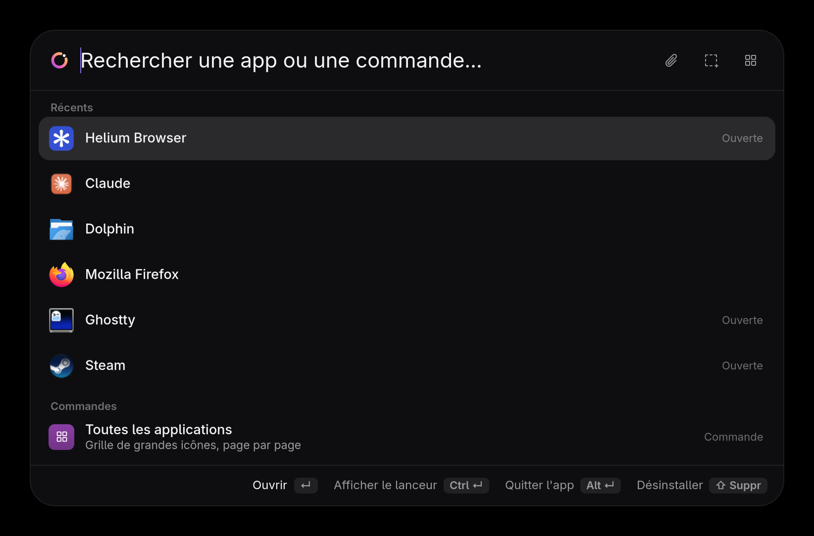<p align="center"><b>Verre</b></p></td>
    <td width="25%">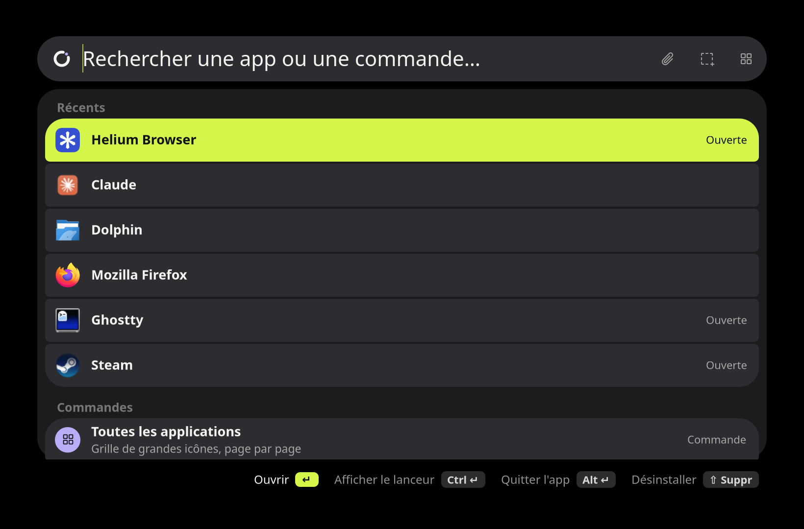<p align="center"><b>Atelier Expressif</b></p></td>
    <td width="25%">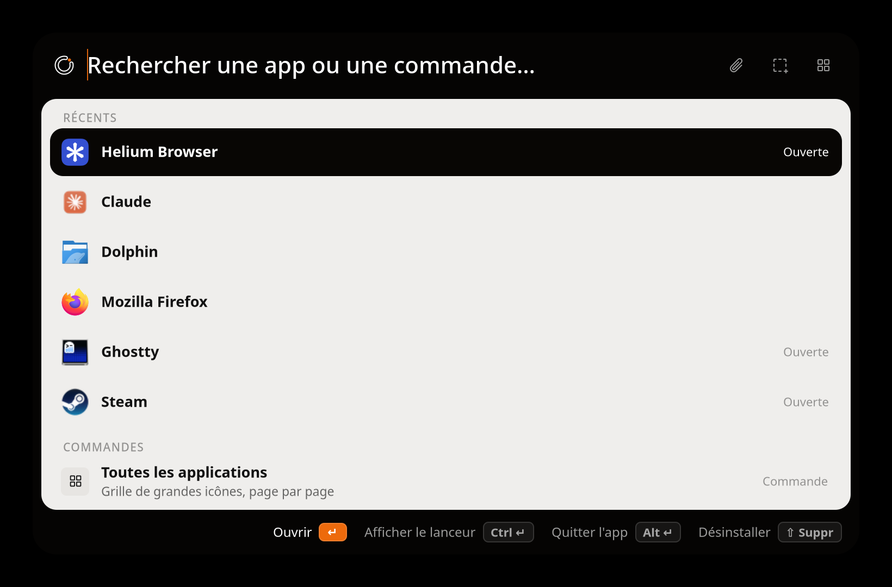<p align="center"><b>Atelier Glyphe</b></p></td>
  </tr>
  <tr>
    <td>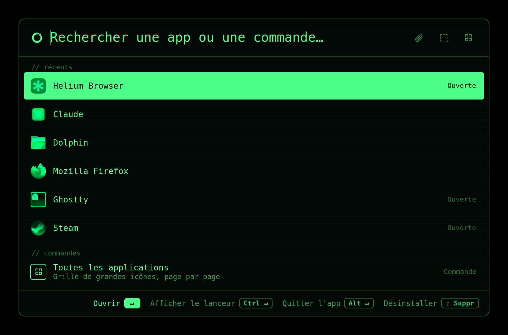<p align="center"><b>Phosphore</b></p></td>
    <td>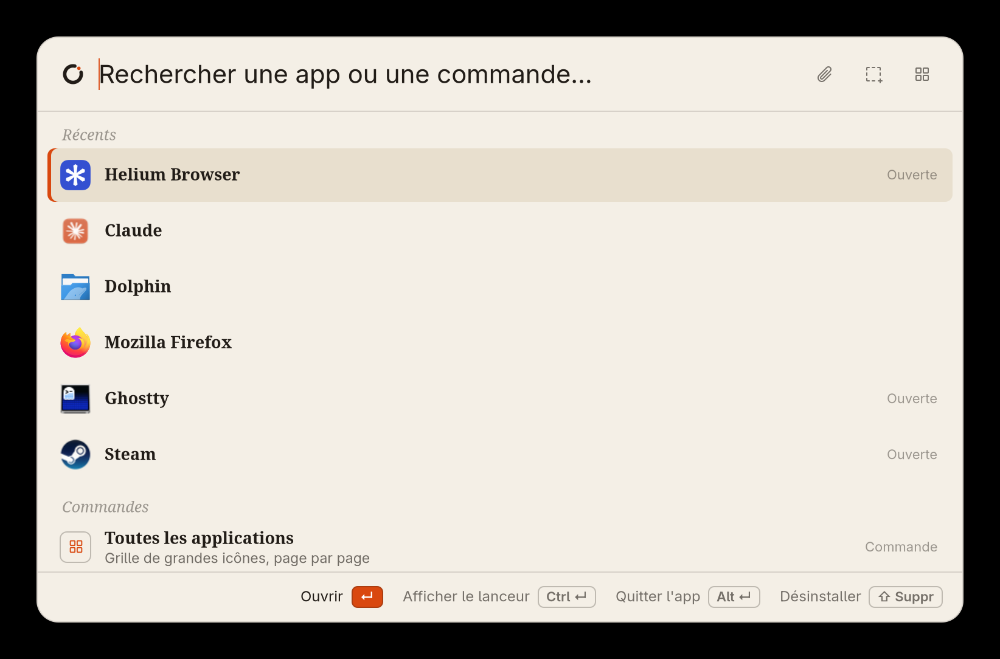<p align="center"><b>Papier</b></p></td>
    <td>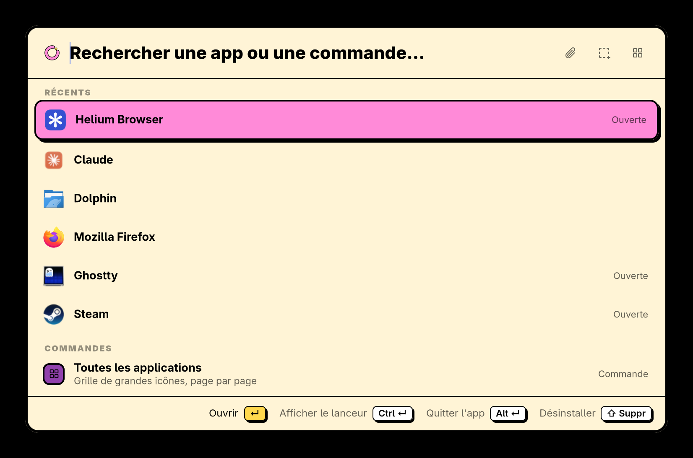<p align="center"><b>Néo-brutal</b></p></td>
    <td><p align="center"><b>Glyphe · Nuit</b></p></td>
  </tr>
</table>

| Style | Matière | À l'ouverture |
|---|---|---|
| **KDE** (par défaut) | suit Plasma : thème de couleurs, couleur d'accentuation et police lus dans `~/.config/kdeglobals`, sélection à la Plasma 6 (accent léger et filet), flou de KWin ; un changement de thème s'applique tout de suite | le panneau glisse comme un menu de Plasma, les lignes suivent, un filet d'accent se trace sous la recherche |
| **Verre** | verre translucide sur le flou de KWin (presque opaque sans flou), teintes réglables | le verre passe du flou au net, un reflet multicolore fait le tour du bord |
| **Atelier Expressif** | Material 3 Expressive : barre de recherche en pilule, listes segmentées, deux accents, Google Sans Flex, cinq thèmes de couleurs | le panneau se déploie depuis la recherche, un anneau de focus s'y dessine |
| **Atelier Glyphe** | noir chaud et un seul accent (six au choix), panneau en retrait dans un cadre noir, sélection inversée, libellés en chasse fixe, logo en points ; une Nuit tout en rouge et au trait (sélection cernée, icônes d'apps dessinées à l'encre), automatique aux heures choisies | une onde de points part du logo, textes et icônes se décodent en ASCII (et, plus brièvement, en tapant et à chaque sélection) |
| **Phosphore** | écran cathodique en chasse fixe, vert, ambre, blanc ou cyan | allumage du tube, balayage, résultats affichés ligne par ligne |
| **Papier** | papier crème, ivoire ou nuit, titres à empattements | la page se déplie, un trait d'encre se trace sous la recherche |
| **Néo-brutal** | contours noirs, ombres pleines, couleurs franches | le panneau tombe et rebondit sur son ombre |

Tout se règle dans **Réglages › Apparence** et **Réglages › Animations** : intensité et vitesse des animations,
densité des lignes, taille du texte, et un **mode focus** qui n'affiche que la barre de recherche à l'ouverture.
Pour changer de style sans ouvrir les réglages, tape `style` dans le panneau.

## Le logo

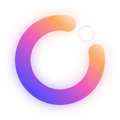

Un anneau ouvert et son point. C'est le « o » de *hello*, et la tête du reflet qui fait le tour du panneau quand il
apparaît. À chaque ouverture, le point s'allume et l'anneau en part pour faire le tour. Dans la barre de recherche, il
prend la matière de chaque style ; dans la zone de notification, les couleurs du thème.
<br clear="left">

## Installation

```sh
git clone https://github.com/matthieuleconte1/HelloLinux.git && cd HelloLinux
./install.sh            # installe dans ~/.local (lanceur, icône, fichier .desktop) et lance Hello
./install.sh uninstall  # retire Hello (les réglages et l'historique restent)
```

Il faut Python GObject, GTK 4 et libadwaita ; gtk4-layer-shell, wl-clipboard et numpy sont fortement conseillés
(`install.sh` dit ce qui manque et la commande pour l'installer). Sur Arch et CachyOS :

```sh
sudo pacman -S --needed python-gobject gtk4 libadwaita gtk4-layer-shell wl-clipboard python-numpy
```

Pour coller directement un emoji ou un élément du presse-papiers dans l'app active, il faut **ydotool**
(`systemctl --user enable --now ydotool`) ; sans lui, Hello copie simplement.

### Mises à jour

Hello se met à jour tout seul depuis les [releases de ce dépôt](https://github.com/matthieuleconte1/HelloLinux/releases).
Il vérifie au lancement puis toutes les 6 heures. Quand une nouvelle version sort, il attend que le panneau soit
fermé et que l'IA ne travaille pas, télécharge l'archive `Hello-linux-<version>.tar.gz`, vérifie qu'il s'agit bien
de Hello à la bonne version, l'installe dans `~/.local/share/hello/app/<version>` puis se relance en arrière-plan.
Une notification annonce la nouvelle version. Tout se règle dans Réglages › Général : vérification, installation
automatique, préversions.

Pour publier une version : changer `__version__` dans `hello/__init__.py`, puis `./install.sh release`
(`./install.sh dist` produit seulement l'archive dans `build/`).

### Le raccourci : Alt Espace

Wayland ne permet pas à une app d'écouter le clavier des autres. Hello demande donc son raccourci au bureau, via le
portail **GlobalShortcuts** (Plasma 6, GNOME 48+, Hyprland). **Alt Espace** est proposé par défaut.

Sur Plasma, Hello s'inscrit directement auprès de kglobalaccel, comme une app KDE native. Alt Espace ouvre
normalement KRunner : au premier lancement, Hello le reprend, et KRunner garde Alt F2 et la touche Recherche. Le
raccourci apparaît dans **Configuration du système › Clavier › Raccourcis › Hello**, où on peut le modifier ; pour
rendre Alt Espace à KRunner, il suffit de l'y réattribuer. Choisir une autre combinaison dans le mode « Raccourci »
du panneau ou dans les réglages la reprend de la même façon. Le raccourci ne fonctionne que pendant que Hello tourne :
lance-le à l'ouverture de session (Réglages › Général, ou `login` dans le panneau).

Sans portail, n'importe quel gestionnaire de raccourcis peut lancer `hello --toggle`.

```sh
hello                 # ouvre le panneau (lance Hello s'il ne tourne pas)
hello --toggle        # ouvre ou ferme
hello --show emoji    # ouvre dans un mode : apps, emoji, clipboard, colors, chats, stats, uninstall…
hello --query "cd ~/" # ouvre avec un texte déjà tapé
hello --settings      # réglages (aussi : Ctrl , dans le panneau)
hello --background    # démarre sans ouvrir (ouverture de session)
hello --quit
```

## L'agent IA

« ? ta demande » (ou une phrase) interroge l'IA, sur trois niveaux : **Fast** répond tout de suite ou choisit le
niveau, **Recherche & Action** cherche sur le web et agit sur l'ordinateur (shell, D-Bus de KDE ou `gsettings`,
captures d'écran), **Code** ouvre une session de code dans le terminal. « ?? » et « ??? » forcent les niveaux 2
et 3. Chaque niveau a son fournisseur : **Hermes**, **Claude Code** ou **Codex** (Réglages › Agent, avec le modèle
et l'effort de raisonnement).

Les réponses s'affichent en Markdown, avec tableaux et formules LaTeX (`$…$`, `$$…$$`, matrices, `cases`,
`aligned`). Une formule simple s'écrit en caractères (𝑥² ≤ 𝛼, sélectionnable) ; les autres sont composées comme le
fait TeX, dans une police mathématique (STIX Two Math, sinon Latin Modern Math, DejaVu Math TeX Gyre ou Noto Sans
Math), et posées sur la ligne de base du texte. L'IA sait qu'elle peut s'en servir.

Sous une réponse, la barre de recherche revient pour une question de suite (↵ niveau 1, Ctrl ↵ niveau 2, Alt ↵
niveau 3) : l'IA reçoit les échanges précédents. Les conversations sont gardées (mode « Conversations »,
`hello --show chats`, ou `/resume`). Les commandes « / » : `/resume`, `/new`, `/fast`, `/work`, `/code`, `/retry`,
`/terminal`, `/copy`, `/delete`, `/memory`, `/model`, `/help`. **Ctrl O** joint des fichiers (glisser-déposer sur le
panneau aussi), **Ctrl ⇧ S** une capture d'écran, **Ctrl V** un fichier ou une image copiés.

## Ce qui change par rapport à macOS

| macOS | Linux |
|---|---|
| NSPanel flottant | surface **layer-shell** au-dessus de tout (un clic à côté referme) ; sinon une fenêtre ordinaire |
| Raccourci Carbon ⌘ Espace | **Alt Espace** via le portail **GlobalShortcuts** (repris à KRunner sur Plasma), ou `hello --toggle` |
| Apps de /Applications | fichiers **.desktop** (Gio), y compris Flatpak ; « Ouverte » lu dans les unités systemd des apps |
| NSPasteboard (compteur) | `wl-paste --watch` (protocole data-control) ; les copies marquées secrètes (KeePassXC…) sont ignorées |
| Collage via l'accessibilité | **ydotool** ; sans lui, Hello copie seulement |
| Pipette NSColorSampler | portail **Screenshot.PickColor** (aucune capture gardée) |
| Masquer la barre des menus | **Panneau Plasma** : toujours visible, masquage auto, esquiver les fenêtres, fenêtres par-dessus |
| Désinstallation AppCleaner | Flatpak (`flatpak uninstall`), paquet (`pacman -Rns`, `apt remove`, `dnf remove` dans le terminal), app locale ; restes dans `~/.config`, `~/.local/share`, `~/.cache`, `~/.var/app` → corbeille |
| ⌘ ↵ / ⌥ ↵ / ⌘ ⌫ | **Ctrl ↵** / **Alt ↵** / **⇧ Suppr** |
| Finder | gestionnaire de fichiers par défaut (Dolphin, Nautilus…) via `org.freedesktop.FileManager1` |
| Terminal / éditeur | Ghostty, kitty, WezTerm, Alacritty, foot, Konsole, Terminal GNOME… / Cursor, VS Code, Zed, Kate… |
| Liquid Glass | verre translucide sur le **flou de KWin** (`backdrop-filter` de GTK, protocole ext-background-effect ; org_kde_kwin_blur sur les KWin plus anciens). Sans flou : verre presque opaque |
| Icône de la barre des menus | icône dans la **zone de notification** (StatusNotifierItem) : clic pour ouvrir, clic droit pour le menu |
| Grille d'apps au trackpad | `Adw.Carousel` : balayage au pavé tactile, molette, Ctrl ← → ou Page ↑ ↓ |
| Capture d'écran pour l'IA (⌘ ⇧ S) | **Ctrl ⇧ S** : portail **Screenshot** interactif (zone, fenêtre ou écran) |
| Joindre un fichier (⌘ O) | **Ctrl O** : sélecteur de fichiers du bureau (portail FileChooser) ; glisser-déposer sur le panneau |
| Coller un fichier ou une image (⌘ V) | **Ctrl V** : fichiers copiés dans Dolphin ou Nautilus, image copiée sans texte (`wl-paste`) |
| Formules en STIX Two Math (Core Text) | composées avec **Pango et Cairo**, dans la première police mathématique installée |
| Icônes au trait (Core Graphics) | **numpy** (sans lui, les icônes de la Nuit restent simplement atténuées) |
| Notification de fin de l'IA | `Gio.Notification` : un clic rouvre la conversation |
| Mise à jour (zip de la release) | archive `Hello-linux-<version>.tar.gz` des releases de HelloLinux, installée seule quand le panneau est fermé |

Ces fonctions sont identiques : recherche floue et frécence (mêmes scores), apprentissage des préfixes, `cd` / `z` /
`>` / `kill` / `port` / `:3000` / `ip`, sortie colorée dans un PTY, historique zsh et bash, zoxide, branche git,
commandes perso `{}`, emoji avec recherche en français, couleurs HEX / RGB / HSL, statistiques, mode focus, les six
peaux et leurs animations d'ouverture, et l'agent IA.

## La zone de notification

Le logo de Hello apparaît dans la zone de notification, aux couleurs du thème. Un clic ouvre ou ferme le panneau. Le
clic droit ouvre le menu de la version Mac : Emoji, Presse-papiers, Pipette, visibilité du panneau Plasma,
Statistiques, Réglages, lancement à l'ouverture de session et Quitter. L'option se trouve dans Réglages › Général.

## Énergie et vie privée

- Un seul processus, sans fenêtre la plupart du temps ; le raccourci passe par le bureau (portail ou kglobalaccel),
  sans rien écouter au repos.
- Index des apps : lecture des fichiers .desktop, refaite au plus une fois par minute à l'ouverture.
- Presse-papiers : `wl-paste --watch` prévient Hello à chaque copie, rien n'est interrogé en boucle. Les copies
  marquées secrètes (KeePassXC, gestionnaires de mots de passe de KDE) sont ignorées.
- Tout reste sur l'ordinateur : réglages dans `~/.config/hello/settings.json` ; statistiques, presse-papiers (0600),
  couleurs et historique dans `~/.local/share/hello/` ; conversations avec l'IA (0600) dans
  `~/.local/share/hello/chats.json` (Réglages › Agent › Mémoire pour les effacer) ; versions installées par la mise à
  jour dans `~/.local/share/hello/app/`. Avec l'IA, la demande et le contexte joint sont transmis au fournisseur
  configuré.
- Les animations respectent le réglage « Réduire les animations » de Plasma ou de GNOME, ainsi que la vitesse choisie
  dans Hello.

## Sous le capot

Environ 13 000 lignes de Python, sur GTK 4 et libadwaita (PyGObject), sans autre dépendance que numpy, facultatif.

| Fichier | Rôle |
|---|---|
| `hello/app.py` | l'application (une seule instance via D-Bus), ouverture et fermeture, démarrage |
| `hello/model.py` | les modes, la recherche, le clavier, les actions (LauncherModel) |
| `hello/ui.py` | le panneau GTK : liste, grille d'apps, emoji, aperçus, terminal, agent |
| `hello/styles.py`, `hello/mark.py`, `hello/decode.py` | les sept peaux (CSS GTK générée, style KDE lu dans kdeglobals), leurs ouvertures (mouvement du panneau, cascade des lignes, signature dessinée), le logo et le décodage ASCII |
| `hello/blur.py`, `hello/tray.py` | détection du flou du compositeur, icône et menu de la zone de notification |
| `hello/prefs.py` | les réglages (libadwaita) |
| `hello/apps.py`, `hello/usage.py`, `hello/fuzzy.py` | index des apps, frécence, recherche floue |
| `hello/shell.py`, `hello/term.py` | commandes, PTY, séquences ANSI, dossiers, processus, ports |
| `hello/clipboard.py`, `hello/glyphs.py`, `hello/colors.py` | presse-papiers, emoji, pipette et panneau Plasma |
| `hello/uninstall.py` | désinstallation |
| `hello/agent.py`, `hello/engines.py` | l'agent et ses trois niveaux ; Hermes, Claude Code et Codex (arguments, flux JSON) |
| `hello/markdown.py`, `hello/latex.py`, `hello/ui_markdown.py` | réponses de l'IA : Markdown et tableaux, composition des formules LaTeX (boîtes à la TeX, Pango et Cairo), widgets GTK |
| `hello/icontrace.py` | icônes au trait de la Nuit (filet et XDoG) et version ASCII des icônes pour le fondu des grilles |
| `hello/chats.py`, `hello/context.py`, `hello/confirm.py` | conversations, pièces jointes et contexte, Échap en deux temps |
| `hello/updater.py` | mises à jour depuis les releases GitHub |
| `hello/hotkey.py`, `hello/portal.py`, `hello/desktop.py` | portails XDG, intégration au bureau |
| `data/icons/` | les icônes de Hello, tirées de [Phosphor](https://phosphoricons.com) (licence MIT, `LICENSE-phosphor`) ; le menu de la zone de notification garde celles du thème, puisque c'est Plasma qui le dessine |

Tests : `python3 -m unittest discover -s tests`.

La bannière et les captures sont produites par du code : `python3 scripts/make-banner.py` et
`python3 scripts/make-screens.py`. Le second lance la vraie fenêtre de Hello dans un KWin virtuel, sans rien afficher
à l'écran, avec des réglages jetables ; il ne reprend que les apps des statistiques, pour les récents.
